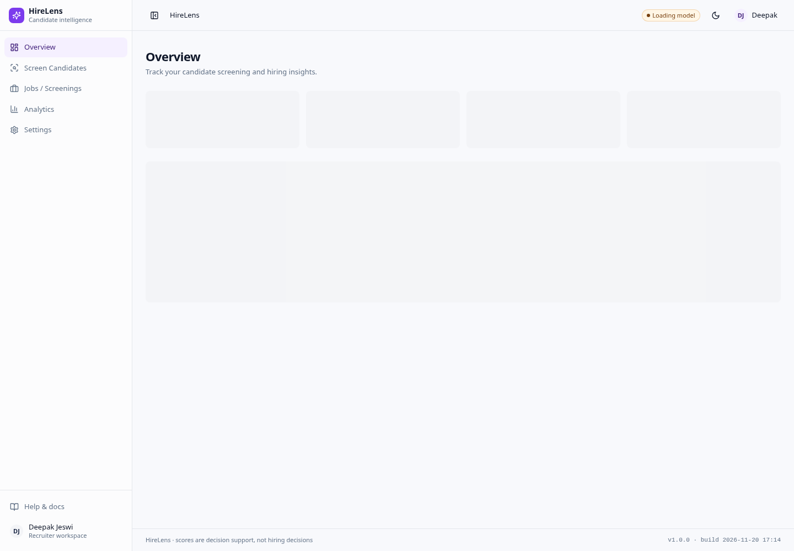
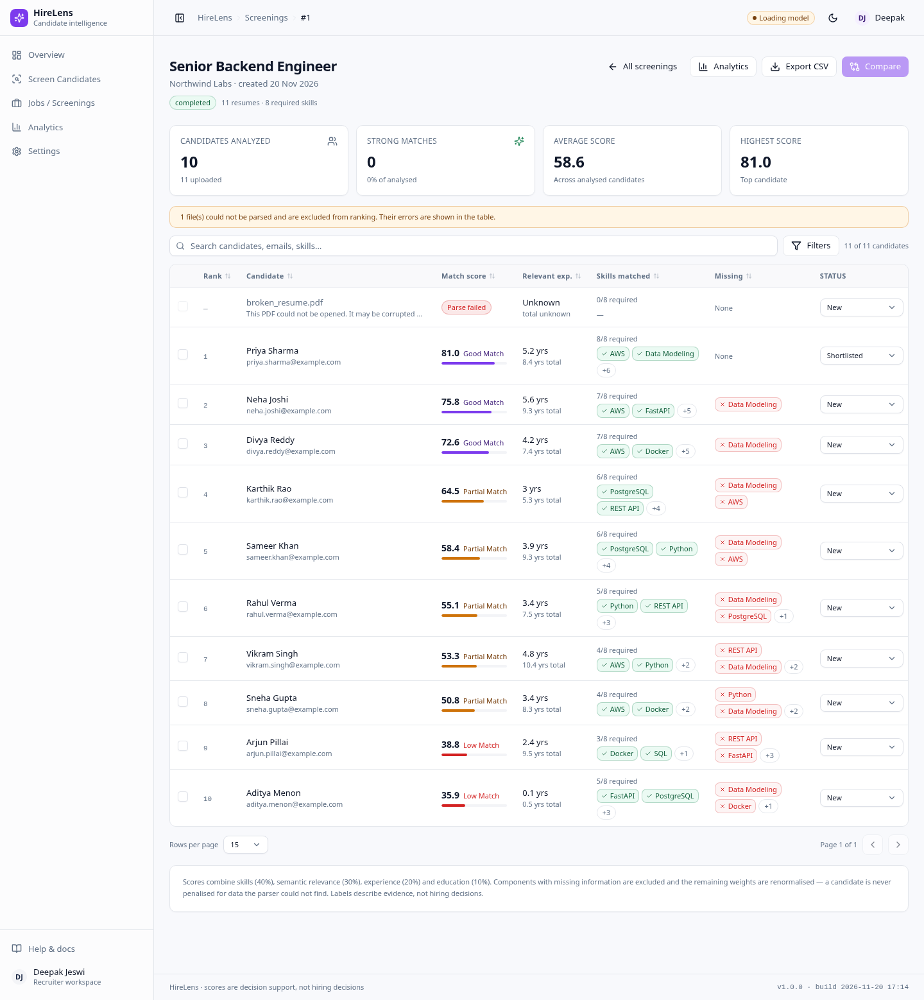
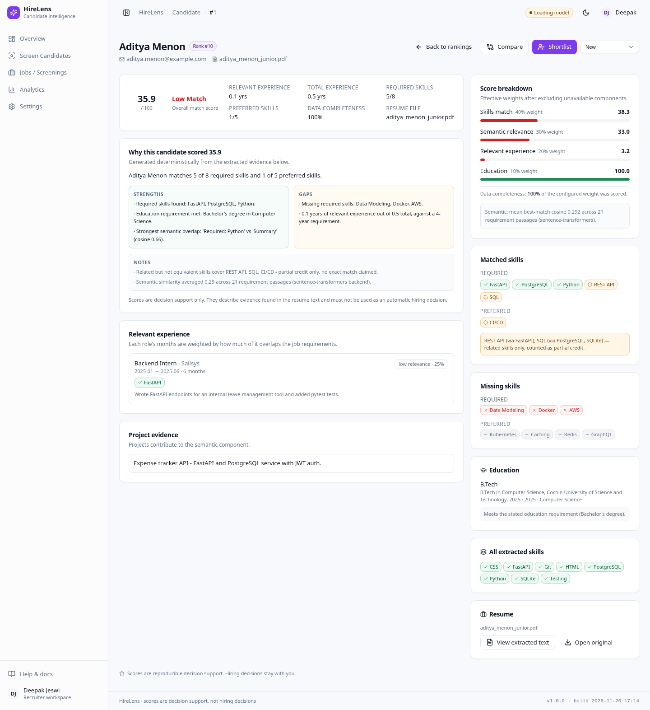
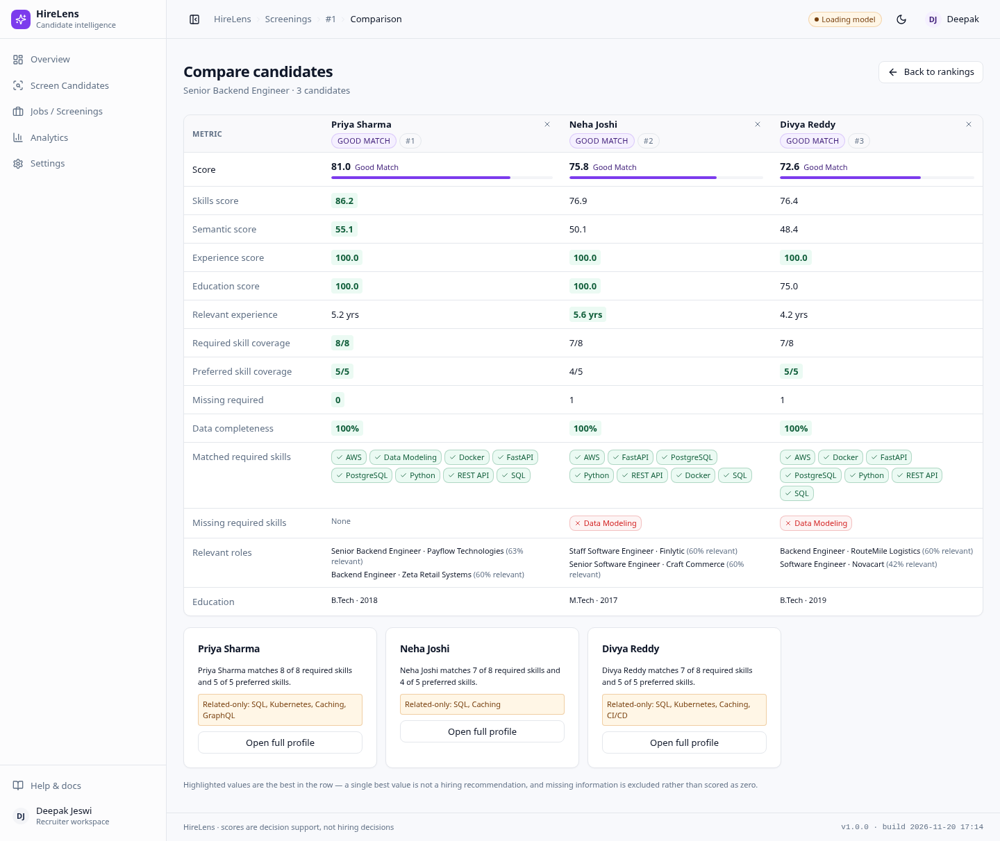
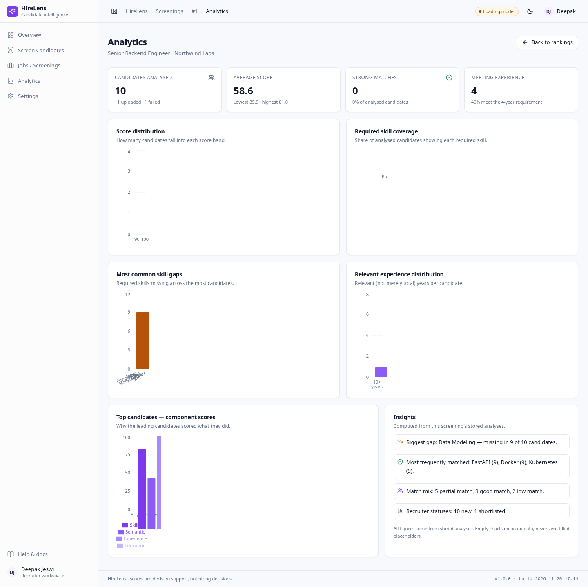
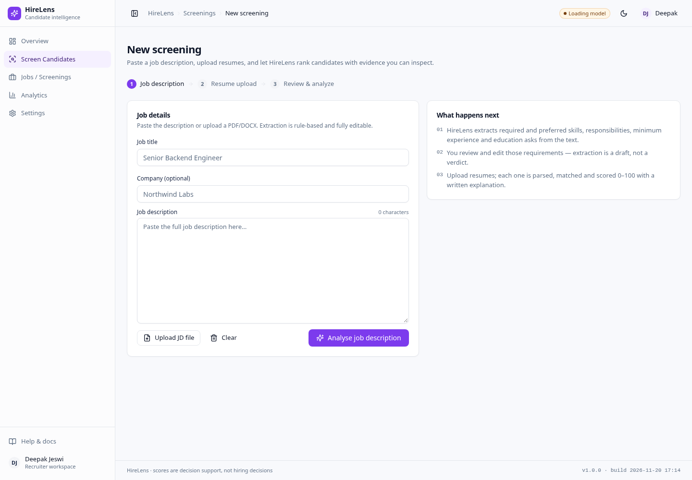

# HireLens

**Find the right talent, backed by evidence.**

HireLens is a full-stack AI resume screening and candidate intelligence platform. A recruiter
pastes a job description, uploads a batch of resumes, and gets a ranked, explainable shortlist:
every candidate has a 0–100 score built from four named components, and every score can be
traced back to the exact evidence in the resume that produced it.

It is a working application, not a mockup: real PDF/DOCX parsing, a real hybrid matching
engine, real persistence, real tests. No paid API keys are required for any core feature.

---

## 1. Product overview

| | |
|---|---|
| Product | HireLens |
| Category | AI recruiting / candidate intelligence |
| Tagline | Find the right talent, backed by evidence. |
| Stack | React + TypeScript + Vite + Tailwind + shadcn-style UI · FastAPI + SQLAlchemy + SQLite · Sentence Transformers |
| Runs on | A laptop. No cloud services, no paid LLM APIs, no external database. |

The workflow: **job description → extracted requirements (editable) → resume batch → analysis →
ranked candidates → compare / shortlist / export → analytics.**

---

## 2. Features

**Screening creation**
- Three-step guided flow: job description → resume upload → review & analyse.
- Job description from paste or from an uploaded PDF/DOCX/TXT file (text extracted server-side).
- Requirement extraction into required skills, preferred skills, responsibilities, minimum
  experience, education asks and industry domains — every item editable, and skills can be moved
  between required and preferred.
- Drag-and-drop batch upload, 10+ resumes at once (default cap 60 per screening), per-file
  validation, duplicate detection by content hash, per-file removal and per-file upload status.

**Processing**
- Background analysis thread with a nine-stage progress feed that reports real backend work
  (files processed, succeeded, failed, current stage, per-file errors).
- One unreadable resume never aborts the batch: the failure is recorded on the candidate and in
  the progress panel, and the rest continue.

**Matching and scoring**
- Hybrid engine: structured skill matching (40%), semantic relevance (30%), relevant experience
  (20%), education (10%).
- Alias-aware skill normalisation with an explicit "related but not equal" relation.
- Deterministic, evidence-grounded explanations: strengths, gaps, missing skills, relevant roles,
  semantic evidence, and the note explaining what was *not* scored and why.
- Missing information is excluded and the remaining weights renormalised — never silently zeroed.

**Review**
- Ranking dashboard with search, sorting, score/label/status/skill/missing-skill/experience
  filters, pagination, and a match-score indicator that is not colour-only.
- Candidate profile: score breakdown with effective weights, matched vs missing skills by
  requirement and match type, per-role relevance, projects, education, certifications, the raw
  extracted resume text and the original file.
- Side-by-side comparison of 2–4 candidates with best-in-row highlighting.
- Analytics per screening: score distribution, required-skill coverage, common gaps, relevant
  experience distribution, top-candidate component comparison, and computed insights.
- Recruiter statuses (new / reviewing / shortlisted / interview / rejected) persisted per
  candidate, plus CSV export of the full result set.
- Screening history with delete-with-confirmation; data survives restarts (SQLite).
- Clearly-labelled synthetic demo mode that runs the *real* pipeline on invented resumes.
- Light theme by default, optional dark theme, responsive down to 390 px.

---

## 3. Screenshots

Captured from the running application (1440 px, real analysed data from ten PDF/DOCX resumes):

| Overview | Rankings |
|---|---|
|  |  |

| Candidate profile | Comparison |
|---|---|
|  |  |

| Analytics | New screening |
|---|---|
|  |  |

Also in `docs/screenshots/`: `02-jobs.png`, `08-settings.png`, `09-help.png`,
`10-search-filter.png`, `11-selection.png`, `12-dashboard-dark.png`, `13-mobile-rankings.png`.

---

## 4. Architecture

```
Browser (React SPA)
   │  REST/JSON + multipart uploads, API base URL from VITE_API_URL (default /api, proxied by Vite)
   ▼
FastAPI app (single process)
   ├─ api/            routes: jobs, candidates, meta (thin, validated, typed)
   ├─ services/
   │    document_parser  → bytes → text (PyMuPDF / python-docx), validation, safe storage
   │    resume_parser    → text → structured profile (sections, dates, education, projects)
   │    jd_analyzer      → JD text → structured requirements
   │    skill_taxonomy   → canonical skills, aliases, related-skill relations
   │    skill_extractor  → span-aware skill detection over free text
   │    skill_matcher    → exact / alias / related / semantic / none per requirement
   │    semantic_matcher → lazily loaded Sentence Transformers model + cosine + calibration
   │    semantic_relevance → requirement-passage vs resume-passage similarity
   │    experience_matcher → dated roles → relevance-weighted relevant years
   │    education_matcher  → degree level + field comparison (only when the JD asks)
   │    scoring_engine     → weighted combination, missing-data policy, labels
   │    explanation        → deterministic sentences from the evidence
   │    ranking_service, analytics_service, progress, pipeline
   ├─ models/ + schemas/  SQLAlchemy entities, Pydantic contracts
   └─ database/           SQLite (WAL) via SQLAlchemy 2.0
```

Analysis runs in a worker thread with its own database session and publishes progress to an
in-process tracker that the client polls. No Celery, no Redis, no message broker — appropriate
for a local single-process prototype, and the progress numbers are real work counters.

---

## 5. Tech stack

**Frontend** — React 18, TypeScript, Vite, Tailwind CSS, shadcn/ui-style components built on
Radix primitives (`@radix-ui/react-dialog|select|dropdown-menu|tabs|tooltip|checkbox|progress|
switch|label|separator|slot`), Lucide icons, Recharts, React Router, TanStack Table, Framer
Motion, React Hook Form + Zod.

**Backend** — Python 3.12, FastAPI, Pydantic v2, SQLAlchemy 2.0, SQLite, Uvicorn.

**NLP/ML** — sentence-transformers (`sentence-transformers/all-MiniLM-L6-v2`), scikit-learn
(TF-IDF/SVD fallback), NumPy, cosine similarity, a hand-maintained skill taxonomy.

**Parsing** — PyMuPDF (PDF), python-docx (DOCX, including tables).

**Testing** — pytest (backend), Vitest + React Testing Library (frontend).

---

## 6. Matching methodology

### A. Skill matching — 40%

Each required and preferred skill is compared against the candidate's extracted skills and the
evidence zones they came from (skills section, summary, work experience, projects,
certifications). Outcomes, in order of strength:

| Outcome | Credit | Meaning |
|---|---|---|
| exact (evidenced) | 1.00 | canonical skill found, demonstrated in work/projects |
| exact (listed) | 0.90 | canonical skill found only in a skills list |
| alias (evidenced) | 0.95 | matched through a known alias ("JS" → JavaScript) |
| alias (listed) | 0.85 | alias, listed only |
| related (evidenced) | 0.45 | a *different but related* skill is present |
| related (listed) | 0.40 | related skill, listed only |
| semantic | 0.25 | no structured evidence, but resume text is semantically close |
| none | 0.00 | no evidence |

Required skills carry 2× the weight of preferred skills. Skill score =
`100 × Σ(weight × credit) / Σ(weight)`. Because evidenced matches outscore listed ones, a padded
skills list cannot inflate a score, and because related skills are capped at 0.45, the UI never
claims an exact match it does not have.

### B. Semantic relevance — 30%

The job side becomes a set of passages: the role title, one sentence per required and preferred
skill, each responsibility, domains and education asks. The resume side becomes the summary, each
role (title + company + description) and each project. For every requirement passage we take the
*best* matching resume passage and average those best similarities — so a requirement can be
satisfied by any one part of the resume, and a long resume cannot drift away from a short JD.

Cosine similarity is **calibrated, not multiplied by 100**. MiniLM puts unrelated text near
0.05–0.15 and genuine paraphrases near 0.55–0.70, so the raw value is mapped through a documented
window (0.15 → 0, 0.58 → 100) with clamping. Semantic similarity is only 30% of the score and can
never override an explicit requirement; it is a supporting signal, not a verdict.

A requirement is only counted as "semantically present" above a cosine threshold (0.38 for the
transformer backend), because below that band two loosely-related engineering sentences look
similar for no good reason.

### C. Relevant experience — 20%

Total experience comes from employment date ranges with **overlapping periods merged**, so the
same months are never counted twice, and years are never inferred from a graduation date.

*Relevant* experience weights each role's months by how much of it overlaps the job:

```
role_factor = max( share of required skills the role's text demonstrates ,
                   0.6 × calibrated semantic similarity(role text, JD core) )
relevant_months = Σ ( role_months × role_factor )
experience_score = 100 × min(relevant_years / required_years, 1)
```

Semantic-only overlap is discounted by 40% because role descriptions are short and embeddings
rate unrelated engineering roles as more similar than they are. A role with no overlap contributes
nothing, so "10 years of unrelated work" cannot beat "3 years of exactly the right work".

### D. Education and qualifications — 10%

Scored only when the job description actually asks for a qualification *and* the resume yielded
education data. Degree level is compared (diploma < bachelor < master < doctorate) and, when the
JD names a field, the field is compared too. If either side is missing, the component is
unavailable rather than zero.

---

## 7. Scoring formula

```
final = 0.40 × skills + 0.30 × semantic + 0.20 × experience + 0.10 × education
```

All components are normalised to 0–100 and the result is clamped and rounded to one decimal.
Weights live in exactly one place — `backend/app/core/config.py::SCORE_WEIGHTS` — and are served
to the client at `GET /api/meta/config`, so the frontend never hardcodes scoring logic.

**Missing-information policy.** Each component reports `available`. Unavailable components are
dropped and the remaining weights are renormalised:

```
effective_weight[i] = weight[i] / Σ(weight of available components)
data_completeness   = Σ(weight of available components) × 100
```

The candidate profile shows the effective weights and the data-completeness figure, and names the
components that were not scored. A candidate is never punished for information the parser could
not find; conversely, a score built from 60% of the weight is visibly marked as such.

**Labels** (descriptive, never a decision): 85–100 Strong Match · 70–84 Good Match · 50–69
Partial Match · 0–49 Low Match.

Scores are reproducible: same inputs, same configuration → same score (covered by a test).

---

## 8. NLP approach

- **No LLM is used for extraction or explanation.** Requirement extraction is rule- and
  dictionary-based (section-aware line classification, cue words such as "must have", "nice to
  have", regex for years and degrees). Explanations are assembled from the structured evidence, so
  they cannot hallucinate an achievement.
- **Section-aware resume parsing** splits a resume into summary / experience / education / skills /
  projects / certifications using heading heuristics, then parses employment blocks around date
  ranges (`Mar 2021 – Present`, `01/2020 - 12/2021`, `2019 to 2021`).
- **Embeddings** are computed lazily (model loads in a background thread at startup) and cached per
  text, so no text is encoded twice during an analysis run.
- **Honest degradation:** if the model cannot be loaded (offline first run, torch missing,
  `HIRELENS_DISABLE_MODEL=1`), semantic similarity falls back to TF-IDF + TruncatedSVD with its
  own calibration window, and the fallback is reported in the header, in Settings and in every
  candidate's analysis. It is never presented as transformer output.

---

## 9. Skill normalization approach

`backend/app/services/skill_taxonomy.py` holds ~110 canonical skills with aliases, a category and
an explicit list of *related* skills. Detection is span-aware: aliases are matched longest-first
and consumed, so "React Native" never also registers as "React", and "JavaScript" never registers
as "Java" (`\b` alone is not enough around symbols such as C++, C# and .NET).

Five distinct outcomes are preserved end-to-end into the UI: **exact**, **alias**, **related**,
**semantic**, **no evidence**. Related skills are deliberately *not* treated as equivalent:

- Java ≠ JavaScript · React ≠ Angular · SQL ≠ MongoDB · AWS ≠ Azure
- Machine Learning is related to Deep Learning, but does not prove it

Aliases handled, among many others: JS → JavaScript, TS → TypeScript, Postgres → PostgreSQL,
RESTful API → REST API, NLP → Natural Language Processing, torch → PyTorch, k8s → Kubernetes,
CI/CD → Continuous Integration and Continuous Deployment.

---

## 10. Project structure

```
hirelens/
├── backend/
│   ├── app/
│   │   ├── main.py                 FastAPI app, CORS, error handling, lifespan
│   │   ├── api/                    routes_jobs, routes_candidates, routes_meta, serializers
│   │   ├── core/                   config.py (all tunables), logging_config.py
│   │   ├── database/               db.py (engine, session, init)
│   │   ├── models/entities.py      Screening, Candidate, CandidateAnalysis
│   │   ├── schemas/schemas.py      Pydantic request/response contracts
│   │   ├── services/               parsing, analysis, matching, scoring, analytics, pipeline
│   │   └── demo/seed.py            synthetic JD + 12 synthetic resumes
│   ├── tests/                      49 pytest tests
│   ├── requirements.txt
│   └── .env.example
├── frontend/
│   ├── src/
│   │   ├── components/ui/          shadcn-style primitives (button, card, dialog, select, …)
│   │   ├── components/layout/      AppShell, Sidebar, Header
│   │   ├── components/candidate/   CandidateTable, ScorePill, SkillTag, StatusSelect
│   │   ├── components/upload/      FileDropzone
│   │   ├── components/screening/   RequirementEditor
│   │   ├── pages/                  Dashboard, NewScreening, Processing, Rankings,
│   │   │                           CandidateProfile, Comparison, Analytics, Jobs, Settings, Help
│   │   ├── services → lib/api.ts   single API service layer
│   │   ├── hooks/                  useFetch, useTheme
│   │   ├── types/index.ts          shared API types
│   │   └── test/                   27 Vitest tests
│   ├── package.json
│   └── .env.example
├── sample_data/                    10 real PDF/DOCX resumes, a JD, and one deliberately corrupt PDF
├── docs/screenshots/
└── README.md
```

---

## 11. Installation

Requirements: Python 3.11+ (3.12 tested), Node 18+ (20 tested), ~1 GB free disk for the model.

```bash
git clone <your-fork> hirelens && cd hirelens

# backend
cd backend
python -m venv .venv && source .venv/bin/activate      # Windows: .venv\Scripts\activate
pip install -r requirements.txt
# CPU-only PyTorch (recommended if you have no GPU):
pip install torch --index-url https://download.pytorch.org/whl/cpu

# frontend
cd ../frontend
npm install
```

`pip install -r requirements.txt` pulls `torch` transitively through sentence-transformers. The
line above replaces it with the much smaller CPU build.

---

## 12. Running the frontend

```bash
cd frontend
npm run dev          # http://localhost:5173 (proxies /api to http://localhost:8000)
```

`VITE_API_URL` overrides the API base URL (default `/api`, i.e. the Vite proxy). For a production
build:

```bash
npm run build && npm run preview   # http://localhost:4173, same proxy
```

---

## 13. Running the backend

```bash
cd backend
uvicorn app.main:app --reload --port 8000
```

- Swagger UI: <http://localhost:8000/docs> · OpenAPI JSON: `/openapi.json`
- SQLite database: `backend/hirelens.db` (created on first start, survives restarts)
- Uploaded files: `backend/data/uploads/<screening_id>/` (private; served only through the API)

Configuration is environment-based — see `backend/.env.example`:

| Variable | Default | Purpose |
|---|---|---|
| `HIRELENS_DATABASE_URL` | `sqlite:///backend/hirelens.db` | any SQLAlchemy URL |
| `HIRELENS_UPLOAD_DIR` | `backend/data/uploads` | private upload directory |
| `HIRELENS_MAX_UPLOAD_MB` | `10` | per-file size limit |
| `HIRELENS_MAX_RESUMES` | `60` | resumes per screening |
| `HIRELENS_SEMANTIC_MODEL` | `sentence-transformers/all-MiniLM-L6-v2` | embedding model |
| `HIRELENS_DISABLE_MODEL` | `0` | `1` forces the TF-IDF/SVD fallback |
| `HIRELENS_LOG_LEVEL` | `INFO` | logging verbosity |

---

## 14. Model download behaviour

The embedding model (~90 MB) is downloaded from the Hugging Face Hub **the first time it is
needed**, in a background thread started at application startup, and cached in the standard
Hugging Face cache (`~/.cache/huggingface`). The API answers immediately while it loads; the
header shows "Loading model" until it is ready, and screening works throughout.

If the download fails (no network, no torch), HireLens does not pretend: the status becomes
`fallback`, the header and Settings show `tfidf-svd`, and each analysis records the method it
actually used. Set `HIRELENS_DISABLE_MODEL=1` to force that path deliberately.

---

## 15. API endpoints

| Method | Path | Purpose |
|---|---|---|
| GET | `/api/health` | liveness + version |
| GET | `/api/meta/config` | score weights, labels, semantic backend, limits |
| GET | `/api/meta/semantic-status` | embedding model state |
| GET | `/api/overview` | dashboard metrics, recent screenings, top candidates |
| POST | `/api/jobs/analyze-jd` | JD text → structured requirements (+ warnings) |
| POST | `/api/jobs/extract-jd-text` | uploaded JD file → text |
| POST | `/api/jobs` | create a screening |
| GET | `/api/jobs` | list screenings (with counts and averages) |
| GET | `/api/jobs/{id}` | screening detail |
| PATCH | `/api/jobs/{id}` | edit job details/requirements before analysis |
| DELETE | `/api/jobs/{id}` | delete screening, candidates, files |
| POST | `/api/jobs/{id}/resumes` | upload 1..n resumes (multipart) |
| POST | `/api/jobs/{id}/analyze` | start analysis (202, background) |
| GET | `/api/jobs/{id}/progress` | nine-stage progress, counters, per-file errors |
| GET | `/api/jobs/{id}/candidates` | ranked candidates with component scores |
| GET | `/api/jobs/{id}/analytics` | charts data computed from stored analyses |
| GET | `/api/jobs/{id}/export` | CSV export (properly quoted) |
| GET | `/api/candidates/{id}` | full profile + analysis + resume text |
| PATCH | `/api/candidates/{id}/status` | recruiter status |
| GET | `/api/candidates/{id}/resume` | original file (private storage only) |
| GET | `/api/candidates/{id}/resume-text` | extracted text |
| POST | `/api/candidates/compare?ids=1&ids=2` | 2–4 candidates side by side |
| POST | `/api/demo/load` | create the synthetic demo screening |

Errors return `{"detail": "..."}` (plus `errors[]` for validation) with proper status codes; stack
traces are logged, never returned.

---

## 16. Testing

```bash
cd backend && python -m pytest -q          # 49 passed
cd frontend && npm test                    # 27 passed
cd frontend && npm run typecheck           # tsc --noEmit, clean
```

What the tests actually cover:

- **Backend (49):** PDF extraction, DOCX extraction including table content, plain text, invalid
  extension, empty file, oversize, corrupt PDF, empty PDF, filename sanitisation; skill aliases,
  Java ≠ JavaScript, React Native ≠ React, related-skill partial credit, symbol-heavy skills
  (C++, C#, .NET); resume name/email/phone extraction, employment date parsing, overlapping-date
  merging, education parsing, missing information staying unknown; JD required vs preferred
  classification, minimum experience, education and domain extraction; skill matching outcomes,
  evidenced > listed, experience ratio scoring, experience unavailable when the JD states no
  requirement, education unknown ≠ zero, weight renormalisation, score bounds, reproducibility,
  explanation grounding, calibration monotonicity; and API tests for the full lifecycle (create →
  upload → duplicate rejection → unsupported type → analyse → progress → candidates → status
  patch → CSV export → analytics → comparison → delete), 404s, validation errors, a corrupt file
  not breaking the batch, and demo mode.
- **Frontend (27):** formatting/threshold helpers, candidate table rendering, search, empty state
  + reset, selection limits, missing-skill rendering, requirement editor add/move/remove/edit
  experience, dashboard empty state, real metrics, API error state, semantic-fallback notice,
  demo load, and the API service layer's error mapping (404, 422 details, unreachable backend,
  comparison query building).

**No accuracy benchmark has been measured.** There is no labelled ground-truth dataset in this
project, so the README does not claim precision, recall or ranking quality — only that the scores
are reproducible and derived from the evidence shown in the UI.

Manual end-to-end verification performed during development (not part of the automated suite):
ten real resumes (5 PDF, 5 DOCX) plus one deliberately corrupt PDF uploaded in one batch against a
real job description; the batch completed with 10 analysed and 1 recorded failure, produced a
ranked list, a working CSV export, comparison, analytics, status persistence across a backend
restart, and a browser pass over every page with no console errors.

---

## 17. Demo mode

`POST /api/demo/load` (or the "Load demo data" button) creates a screening flagged `is_demo` with
one sample job description and **12 synthetic resumes** — invented people, invented employers,
invented dates. They are run through the *same* pipeline as real uploads, so the scores are
genuinely computed from the synthetic text rather than hardcoded.

Demo data is always labelled in the UI ("synthetic demo data"), never mixed into a real screening,
and real uploads always trigger real processing.

---

## 18. Limitations

- **English-language resumes and job descriptions** are what the taxonomy and regexes target.
- **No OCR.** Scanned/image PDFs yield almost no text; the file is reported as unreadable
  (`ocr_suspected`) instead of being scored on nothing.
- **Heuristic parsing.** Resumes with unusual layouts, multi-column PDFs, tables-as-images or
  missing date ranges produce incomplete profiles — which the UI surfaces as warnings and as
  "not scored" components rather than inventing data.
- **Semantic scores are relative.** Cosine similarity is calibrated on one model
  (`all-MiniLM-L6-v2`); the absolute numbers are only meaningful within this configuration, which
  is why the semantic component is capped in influence and documented rather than treated as truth.
- **Skill taxonomy is hand-maintained** (~110 canonical skills). Unknown skills are still detected
  as plain terms by the semantic component but are not normalised.
- **Single-process prototype.** Analysis runs in an in-process thread with an in-memory progress
  tracker; progress for a screening is lost on restart (results are persisted, progress is not).
  A multi-worker deployment would need a real queue.
- **No authentication.** HireLens has no login and no per-user data isolation — it is a local
  single-recruiter tool as specified. Do not expose it to the internet as-is.
- **Re-analysis replaces results.** Running analysis again recomputes every score (statuses are
  preserved, previous analyses are overwritten).

---

## 19. Future improvements

- OCR (Tesseract) for scanned resumes, with an explicit "text was OCR'd" flag.
- Learning-to-rank from recruiter decisions (shortlist/reject) to calibrate weights per team,
  with the current explainable scoring kept as the baseline and fallback.
- Expandable skill taxonomy with an admin UI, plus per-tenant skill dictionaries.
- Streaming progress over SSE/WebSocket instead of polling.
- Resume de-duplication across screenings, and candidate merge across job applications.
- Authentication, workspaces, and per-role access control.
- PDF preview of the original resume (currently: extracted text + download).
- A labelled evaluation set to measure ranking quality honestly, and a calibration report.

---

## Ethical guardrails built in

- Protected or irrelevant attributes (name, gender, age, location, phone) are **never** used in
  scoring; phone is extracted only for display.
- Labels describe evidence, not decisions. Nothing is auto-rejected; statuses are recruiter-set.
- Parser uncertainty is shown as *uncertain*, never as "candidate lacks this skill".
- Explanations are generated only from extracted evidence, and every profile carries the
  disclaimer that scores are decision support.
